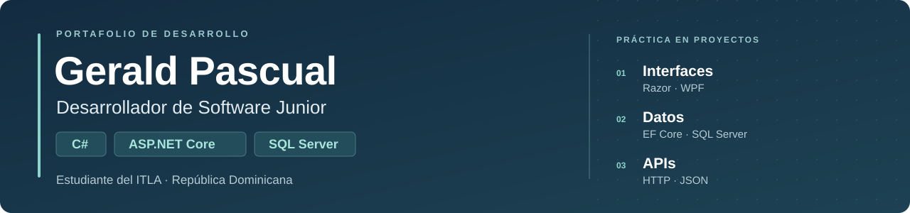

Soy estudiante de **Desarrollo de Software en el ITLA**, en Santo Domingo, República Dominicana. Mi enfoque es el desarrollo de aplicaciones con **C#, ASP.NET Core y SQL Server**.

Busco mi **primera oportunidad como desarrollador junior o pasante**. Aquí reúno proyectos académicos, prácticas y contribuciones que muestran lo que estoy aprendiendo y construyendo.

[LinkedIn](https://www.linkedin.com/in/gerald-jose-pascual-matos-2119573a7/) · [Mi contribución a SmartRestaurant](https://github.com/SmartRestaurant-ITLA/SmartRestaurant/pull/1)

## Proyectos seleccionados

| Proyecto | Qué puedes revisar | Tecnologías |
| --- | --- | --- |
| [SmartRestaurant](https://github.com/SmartRestaurant-ITLA/SmartRestaurant/pull/1) | Mi aporte al frontend de reservas: cuatro vistas Razor, selector de mesas, validaciones y ViewModels. Contribución presentada en el PR #1; integración con backend pendiente. | C#, ASP.NET Core MVC, Razor, Bootstrap, CSS |
| [GPulseMarket](https://github.com/GeraldPascual30/GPulseMarket) | Aplicación académica de escritorio para clientes, productos y facturas, con resumen de ventas y alertas de inventario. | C#, .NET 8, WPF, EF Core, SQL Server |
| [DevOps Task Board](https://github.com/GeraldPascual30/Dise-o-Implementaci-n-Pipeline-DevOps) | Tablero CRUD con API REST, pruebas unitarias y de integración, contenedores, configuración de CI/CD y monitoreo. | Node.js, Express, SQLite, Docker, GitHub Actions |
| [Pruebas con Selenium](https://github.com/GeraldPascual30/selenium_project) | Prácticas de login y navegación administrativa en OrangeHRM, con Page Object Model, capturas y reporte HTML. | Python, Selenium, pytest |
| [Utilidades con React](https://github.com/GeraldPascual30/aplicacion-react-gerald-pascual) | Ejercicios interactivos de suma, números a letras y tablas de multiplicar, con proyecto Android mediante Capacitor. | JavaScript, React, Vite, Capacitor |

## Conocimientos

- **Base principal:** C#, ASP.NET Core MVC, Web API, SQL y SQL Server.
- **Interfaces y datos:** Razor, HTML, CSS, Bootstrap, WPF y Entity Framework Core.
- **Trabajo con código:** Git, GitHub y Visual Studio.
- **Práctica complementaria:** React, Docker, GitHub Actions y automatización con Selenium y pytest.

Los proyectos están identificados como trabajo académico o práctica. En proyectos de equipo enlazo mi contribución concreta.

## Formación

**Tecnólogo en Desarrollo de Software - ITLA**  
2022 - actualidad

| Curso completado | Institución o programa | Fecha |
| --- | --- | --- |
| English for IT 1 | Cisco Networking Academy / ITLA | Octubre de 2026 |
| IT Essentials: PC Hardware and Software | Cisco Networking Academy | Agosto de 2023 |

**Idiomas:** español nativo e inglés básico-intermedio para lectura técnica.

## Contacto

Puedes conocer mi perfil y contactarme a través de [LinkedIn](https://www.linkedin.com/in/gerald-jose-pascual-matos-2119573a7/).
